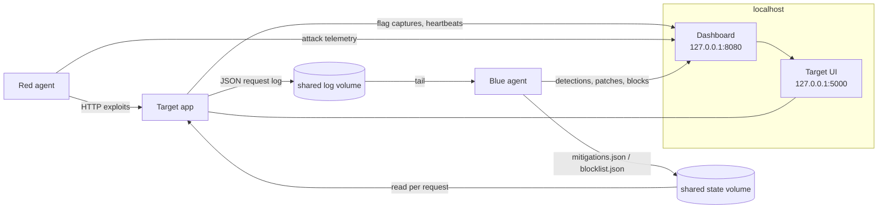

# War Zone

A self-contained Attack/Defend web CTF range that runs entirely on your
machine. A deliberately vulnerable Flask app sits in the middle; an automated
red-team agent attacks it, a blue-team agent defends it in real time, and a
live dashboard shows the fight.

Everything is pinned to loopback and the Compose network. Nothing in here
targets, scans, or talks to anything off your host, and the attacker is wired
to refuse any target but the lab (see [SECURITY.md](SECURITY.md)).

## What's inside

| Component | Path | Role |
|-----------|------|------|
| Target app | `services/target_app` | Flask app with three intentional OWASP bugs and a rotating flag |
| Red agent | `agents/red_team` | Automated recon, exploitation, and flag submission |
| Blue agent | `agents/blue_team` | Log monitor with WAF signatures, threat scoring, hot-patching, and rate limiting |
| Dashboard | `dashboard` | Socket.IO scoreboard, SLA gauge, and live event feed |

## Architecture



The target writes one JSON line per request to a shared log volume. The blue
agent tails that log, matches WAF signatures, and reacts by writing to a shared
state volume. The target re-reads that state on every request, so a fix or a
block takes effect immediately with no restart. All three parties post events
to the dashboard, which keeps the score and streams the feed to the browser.

## The vulnerabilities

Each bug has a safe code path that the blue team switches on at runtime.

### SQL injection — `POST /api/v1/auth/login`

Credentials are concatenated straight into the query. `admin' -- ` logs in as
the administrator, whose session response leaks the live flag. The patched path
uses a parameterized query.

### Stored XSS — `/api/v1/comments`

Comment bodies are stored and rendered without escaping. A simulated admin
browser periodically views the notes; when it hits an unescaped script payload
it "runs" it and leaks its session flag back into the thread. The patched path
HTML-escapes every comment on the way in.

### Command injection / arbitrary file read — `POST /api/v1/diagnostics/ping`

The host field is interpolated into a shell command, so
`127.0.0.1; cat /flags/flag_current.txt` reads the flag file. The patched path
validates the host and runs `ping` with an argument list and no shell.

## Flags

A single flag lives in two places at once — the `flags` table (reachable via
SQLi) and `/flags/flag_current.txt` (reachable via the file read) — and the
stored-XSS path leaks the same value at runtime. It rotates on a timer
(`FLAG_ROTATE_SECONDS`, default 180s), and each attack class scores once per
flag.

## Running the lab

Requirements: Docker and the Compose plugin.

```bash
docker compose up --build
```

- Target console: http://localhost:5000
- Live dashboard: http://localhost:8080

The target and blue team come up together. Launch an attack round whenever you
want:

```bash
docker compose run --rm red_team full-auto
```

Watch the dashboard: red's score climbs as flags are captured, then blue's WAF
fires, the patch chips flip to green, the attacker IP gets rate-limited, and
later rounds capture less. The SLA gauge stays at 100% because blue only blocks
the attacker, never the health checks.

Other red-team subcommands:

```bash
docker compose run --rm red_team recon   # fingerprint only
docker compose run --rm red_team sqli     # single vector
docker compose run --rm red_team xss
docker compose run --rm red_team cmdi
```

## Running the tests

Outside Docker, with the dev dependencies installed:

```bash
pip install flask requests beautifulsoup4 flask-socketio pytest
bash tests/run_all.sh
```

That runs every component's unit suite and a standalone end-to-end smoke test
(`tests/e2e_smoke.py`) that boots the target against temporary storage and
recovers the live flag through all three vectors.

## Threat model and mitigations

A full write-up — assets, entry points, per-vector attack and defence, and the
residual risks of the lab's own design — is in
[`docs/threat_model.md`](docs/threat_model.md).

## Layout

```
services/target_app   # vulnerable Flask app, flag rotation, request logging
agents/red_team       # recon + per-vector exploits + submission (lab-locked)
agents/blue_team      # log tailer, WAF, scoring, hot-patch, rate limit
dashboard             # Socket.IO orchestrator and live UI
tests                 # suite runner + end-to-end smoke test
docs                  # threat model
```
